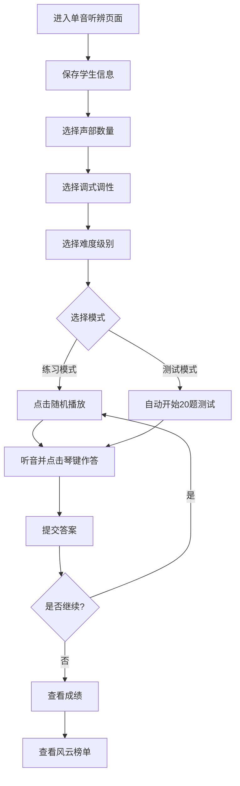
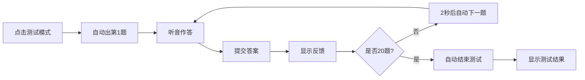
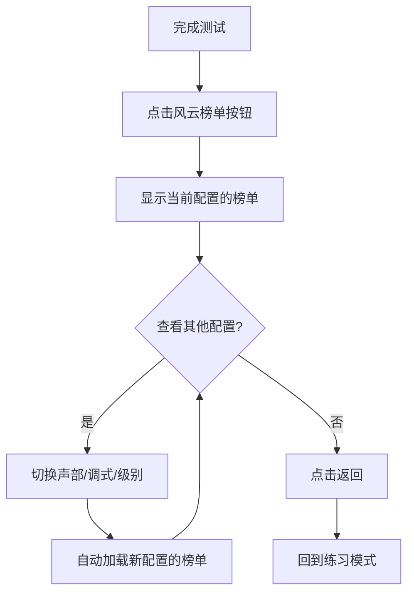

# 单音听辨使用说明

## 📋 目录
- [功能概述](#功能概述)
- [快速开始](#快速开始)
- [操作流程](#操作流程)
- [练习模式](#练习模式)
- [测试模式](#测试模式)
- [风云榜单](#风云榜单)
- [常见问题](#常见问题)

---

## 功能概述

单音听辨是音乐 ear training（练耳）的基础模块，通过听辨单个音符的音高，训练学生的音准感知能力。

**核心功能：**
- ✅ 支持多种声部配置（单声部、双声部、三声部、四声部）
- ✅ 12种调式调性选择（C大调、G大调、D大调等）
- ✅ 8个难度级别（根据音符数量分级）
- ✅ 实时反馈与成绩统计
- ✅ 风云榜单排名系统

---

## 快速开始

### 1. 保存学生信息（可选但推荐）
```
填写：学校、班级、姓名、老师 → 点击"保存"
```
> **提示：** 保存后可参与风云榜单排名

### 2. 选择训练配置
```
① 选择声部数量（单声部/双声部/三声部/四声部）
② 选择调式调性（如：C大调）
③ 选择难度级别（1级-8级）
```

### 3. 选择模式
```
点击"练习模式"或"测试模式"按钮
```

---

## 操作流程

### 完整训练流程



### 详细步骤

#### 步骤1：配置训练参数

**声部选择：**
- **单声部**：每次播放1个音符（基础训练）
- **双声部**：每次播放2个音符（和声训练）
- **三声部**：每次播放3个音符（进阶训练）
- **四声部**：每次播放4个音符（高级训练）

**调式调性：**
- 从下拉菜单选择（如：C大调、G大调、a小调等）
- 钢琴键盘会自动高亮显示该调式的可用音符
- 灰色琴键表示不在当前调式范围内

**难度级别：**
- **1级**：5个音符（最简单）
- **2级**：7个音符
- **3级**：9个音符
- **4级**：11个音符
- **5级**：13个音符
- **6级**：15个音符
- **7级**：17个音符
- **8级**：19个音符（最难）

> **注意：** 级别越高，可用音符范围越广，难度越大

#### 步骤2：开始训练

**练习模式：**
1. 点击"练习模式"按钮
2. 点击"随机播放"按钮出题
3. 聆听播放的音符
4. 在钢琴键盘上点击对应的琴键
5. 点击"提交答案"或直接点击琴键提交
6. 系统显示对错反馈
7. 可点击"重复播放"重新听题
8. 可点击"旋律播放"按顺序听多个音符

**测试模式：**
1. 点击"测试模式"按钮
2. 系统自动开始20题测试
3. 每题限时作答
4. 右上角显示实时成绩和用时
5. 完成20题后自动结束测试
6. 也可手动点击"结束测试"提前结束

---

## 练习模式

### 功能特点

✅ **无压力学习**：答错不扣分，可反复练习  
✅ **即时反馈**：立即显示正确答案  
✅ **自由重听**：可多次点击"重复播放"  
✅ **视觉辅助**：钢琴键盘高亮显示可用音符  

### 操作按钮

| 按钮 | 功能 | 说明 |
|------|------|------|
| 随机播放 | 随机出一道题 | 根据当前配置生成音符 |
| 重复播放 | 重新播放当前题目 | 不限次数 |
| 旋律播放 | 按顺序播放多声部音符 | 适合多声部训练 |
| 提交答案 | 提交当前选择 | 也可通过点击琴键自动提交 |
| 显示答案 | 直接显示正确答案 | 不会时使用 |

### 界面元素

- **状态栏**：显示当前操作提示和答题反馈
- **钢琴键盘**：可点击作答，高亮显示已选音符
- **计分板**：隐藏（练习模式不显示成绩）
- **计时器**：隐藏（练习模式不限时）

### 使用技巧

💡 **初学者建议：**
1. 从单声部 + C大调 + 1级开始
2. 多用"重复播放"熟悉音高
3. 不确定时点击"显示答案"学习
4. 逐步提升级别和声部数量

💡 **进阶训练：**
1. 尝试多声部同时听辨
2. 使用旋律播放训练音程感
3. 挑战高级别扩大音域范围

---

## 测试模式

### 功能特点

🎯 **标准化测试**：固定20题，满分100分  
⏱️ **限时作答**：记录总用时  
📊 **成绩统计**：正确数、错误数、得分率  
🏆 **榜单排名**：成绩自动计入风云榜单  

### 测试规则

- **题量**：20题（固定）
- **分值**：每题5分，满分100分
- **计时**：从第1题开始到最后一题结束
- **自动结束**：完成20题后自动结束
- **手动结束**：可随时点击"结束测试"提前结束

### 界面元素

- **计分板**（右上角）：
  - 得分：当前总分
  - 正确：答对题数
  - 错误：答错题数
  - 进度：X/20题
  
- **计时器**（右上角）：
  - 用时：累计答题时间（MM:SS.ms）
  - 当前时间：系统时间

- **状态栏**：显示答题反馈（✅答对了 / ❌答错了）

### 操作流程



### 注意事项

⚠️ **测试中限制：**
- 不能使用"显示答案"按钮（已禁用）
- 不能使用"旋律播放"（已禁用）
- 不能切换声部按钮（已锁定当前声部）
- 不能切换到练习模式（需结束后再切换）

✅ **测试中可用：**
- 随机播放（自动触发）
- 重复播放（可多次重听）
- 钢琴键盘点击作答

### 测试结束页

测试完成后显示：
1. **成绩汇总**：总分、正确率、用时
2. **详细统计**：正确数、错误数
3. **错题分析**：可查看每道错题的正确答案
4. **操作按钮**：
   - "练习模式"：返回练习模式初始状态
   - "风云榜单"：查看当前配置的排名

---

## 风云榜单

### 功能概述

风云榜单展示所有学生在不同配置下的测试成绩排名，激励学生不断进步。

### 数据隔离规则

榜单按照**四维配置**独立存储：
```
存储键格式：singlePitchLeaderboard_v{声部}_{调式}_{级别}

示例：
- singlePitchLeaderboard_v1_C大调_1  （单声部+C大调+1级）
- singlePitchLeaderboard_v2_G大调_3  （双声部+G大调+3级）
- singlePitchLeaderboard_v3_a小调_5  （三声部+a小调+5级）
```

**这意味着：**
- 不同声部的成绩分开排名
- 不同调式的成绩分开排名
- 不同级别的成绩分开排名
- 只有完全相同配置的成绩才会在一起比较

### 排名规则

🥇 **排序优先级：**
1. **分数优先**：高分排前面
2. **用时其次**：同分时，用时短的排前面

**示例：**
```
排名  姓名  得分  用时
1     张三  100  03:25.50  ← 满分且最快
2     李四  100  04:10.30  ← 满分但较慢
3     王五  95   03:50.20  ← 分数较低
```

### 榜单显示

**顶部配置信息：**
```
当前榜单：单声部 | C大调 | 1级
```

**榜单列表：**
- 显示前10名
- 前三名有特殊标识（🥇🥈🥉）
- 每行显示：排名、姓名、得分、用时

### 操作功能

| 按钮 | 功能 | 说明 |
|------|------|------|
| 清空榜单 | 删除当前配置的榜单数据 | 需确认，不可恢复 |
| 返回 | 返回练习模式 | 恢复到练习模式初始状态 |

### 动态切换

在风云榜单界面可以：
1. **切换声部**：点击不同的声部按钮，立即显示对应声部的榜单
2. **切换调式**：更改调式下拉菜单，立即显示新调式的榜单
3. **切换级别**：更改级别下拉菜单，立即显示新级别的榜单

> **重要：** 榜单显示的是**当前界面选择的配置**对应的数据，不是练习模式的配置。

### 查看榜单流程



### 使用场景

📈 **学生自我激励：**
- 查看自己在某个配置的排名
- 设定目标超越前面的同学
- 尝试不同配置寻找优势项目

👨‍🏫 **教师教学管理：**
- 了解学生对不同配置的掌握程度
- 发现需要加强训练的调式或级别
- 组织班级竞赛活动

---

## 常见问题

### Q1: 为什么我的成绩没有出现在榜单上？

**可能原因：**
1. ❌ 未保存学生信息（姓名必填）
2. ❌ 查看的配置与测试时的配置不一致
3. ❌ 未完成测试（中途退出）

**解决方法：**
1. 填写并保存学生信息
2. 确保榜单界面的配置（声部、调式、级别）与测试时完全一致
3. 完成至少1题后再结束测试

### Q2: 如何查看不同配置的榜单？

**方法：**
1. 进入风云榜单界面
2. 切换声部按钮（单声部/双声部等）
3. 或更改调式下拉菜单
4. 或更改级别下拉菜单
5. 榜单会自动更新显示对应配置的数据

### Q3: 练习模式和测试模式有什么区别？

| 对比项 | 练习模式 | 测试模式 |
|--------|----------|----------|
| 题量 | 无限 | 固定20题 |
| 计分 | 不计分 | 每题5分，满分100 |
| 计时 | 不限时 | 记录总用时 |
| 显示答案 | ✅ 可用 | ❌ 禁用 |
| 旋律播放 | ✅ 可用 | ❌ 禁用 |
| 榜单记录 | ❌ 不记录 | ✅ 自动记录 |
| 压力程度 | 低 | 高 |

### Q4: 如何提高听辨准确率？

**建议：**
1. 🎵 从低级别开始，循序渐进
2. 🔄 多使用"重复播放"熟悉音高
3. 🎹 结合钢琴键盘视觉记忆
4. 📝 记录常错的音符重点练习
5. ⏰ 测试前先充分练习

### Q5: 榜单数据会丢失吗？

**数据存储：**
- 榜单数据保存在浏览器 localStorage 中
- 清除浏览器缓存会导致数据丢失
- 建议定期导出重要数据（未来版本可能支持）

**数据隔离：**
- 每个配置独立存储，互不影响
- 清空榜单只会清空当前配置的数据

---

## 快捷键提示

虽然本应用主要使用鼠标/触摸操作，但以下技巧可提升效率：

- **快速重听**：连续点击"重复播放"按钮
- **快速作答**：直接点击琴键即可提交（无需点提交按钮）
- **快速切换**：在榜单界面快速切换配置查看不同排名

---

## 技术支持

如遇问题，请检查：
1. ✅ 浏览器是否为最新版本（推荐Chrome/Firefox/Safari）
2. ✅ 是否允许网页播放音频
3. ✅ 音量是否正常开启
4. ✅ 是否在网络环境下使用（部分资源需在线加载）

---

**最后更新：** 2026年5月  
**版本：** v1.0
