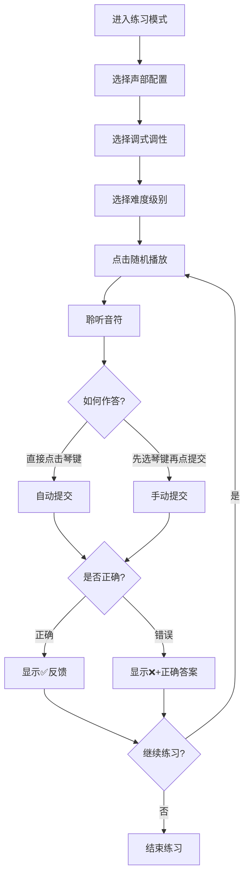
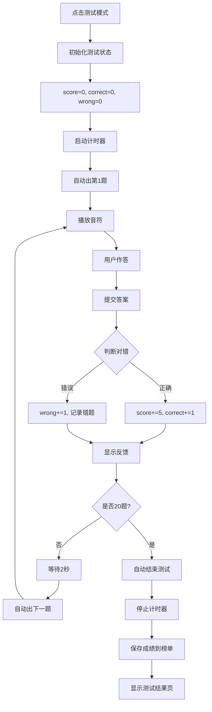

# 单音听辨模式详解

## 📋 目录
- [概述](#概述)
- [练习模式](#练习模式)
- [测试模式](#测试模式)
- [风云榜单](#风云榜单)
- [模式对比](#模式对比)
- [最佳实践](#最佳实践)

---

## 概述

单音听辨模块包含三种核心模式，每种模式针对不同的学习目标和场景设计。

### 三种模式概览

| 模式 | 适用场景 | 核心目标 | 数据记录 |
|------|----------|----------|----------|
| **练习模式** | 日常训练、技能提升 | 熟练掌握音高听辨 | ❌ 不记录 |
| **测试模式** | 能力评估、成绩考核 | 检验学习成果 | ✅ 记录到榜单 |
| **风云榜单** | 竞争激励、排名查看 | 了解相对水平 | 📊 展示排名 |

---

## 练习模式

### 🎯 设计理念

**无压力学习环境**：允许犯错、鼓励探索、注重过程而非结果。

### 核心特性

#### 1. 自由练习
- ✅ 无限次出题，想练多久练多久
- ✅ 答错无惩罚，可立即重试
- ✅ 可随时查看正确答案
- ✅ 支持多种播放方式（随机/重复/旋律）

#### 2. 即时反馈
```
用户作答 → 系统判断 → 显示反馈 → 钢琴高亮正确答案
```

**反馈类型：**
- ✅ **回答正确**：绿色提示 + 正确答案高亮
- ❌ **回答错误**：红色提示 + 显示正确答案

**反馈时长：** 短暂显示后自动清除，避免干扰下一题

#### 3. 视觉辅助
- **钢琴键盘高亮**：当前调式的可用音符以正常颜色显示
- **禁用琴键灰色**：不在调式范围内的琴键变灰且不可点击
- **已选音符标记**：用户点击的琴键保持高亮状态

#### 4. 多声部支持
- **单声部**：播放单个音符
- **双声部**：同时播放两个音符（和弦）
- **三声部**：同时播放三个音符
- **四声部**：同时播放四个音符

**旋律播放功能：**
- 按顺序逐个播放多声部音符
- 帮助学生理解声部间的关系
- 适合初学者逐步建立和声概念

### 界面布局

```
┌─────────────────────────────────────┐
│  [返回]  [截屏]                     │
├─────────────────────────────────────┤
│  学生信息: [学校] [班级] [姓名] [老师] [保存] │
├─────────────────────────────────────┤
│  [单声部] [双声部] [三声部] [四声部]        │
│  [练习模式] [测试模式]                │
├─────────────────────────────────────┤
│  调式调性: [C大调 ▼]  级别: [1级 ▼]   │
├─────────────────────────────────────┤
│  状态栏: 已切换到单声部练习模式...      │
├─────────────────────────────────────┤
│  [随机播放] [重复播放] [旋律播放]       │
│  [提交答案] [显示答案]                │
├─────────────────────────────────────┤
│         🎹 钢琴键盘区域 🎹            │
│  (白色琴键 + 黑色琴键，部分灰色禁用)     │
└─────────────────────────────────────┘
```

### 操作流程



### 使用技巧

#### 初学者路径
```
第1周: 单声部 + C大调 + 1-2级
第2周: 单声部 + G大调/D大调 + 3-4级
第3周: 双声部 + C大调 + 2-3级
第4周: 尝试更多调式和更高级别
```

#### 进阶训练法
1. **盲听训练**：不看钢琴键盘，纯靠听觉作答
2. **快速反应**：限制自己在3秒内作答
3. **多调式切换**：每天练习不同调式，培养调性感
4. **和声感知**：多用双声部/三声部的旋律播放功能

#### 常见问题解决

**Q: 为什么有些琴键是灰色的？**  
A: 这些琴键不在当前选择的调式范围内。例如C大调只有白键，没有黑键。

**Q: 如何提高准确率？**  
A: 
- 多使用"重复播放"熟悉音高
- 结合钢琴键盘的视觉记忆
- 从低级别开始，循序渐进
- 记录常错的音符重点练习

**Q: 可以跳过某题吗？**  
A: 可以点击"显示答案"查看正确答案，然后继续下一题。

---

## 测试模式

### 🎯 设计理念

**标准化能力评估**：固定题量、统一评分、客观公正、可横向比较。

### 核心特性

#### 1. 标准化测试流程
- **固定题量**：20题（不可更改）
- **统一分值**：每题5分，满分100分
- **自动计时**：从第1题到最后一题的总用时
- **自动流转**：答完一题后2秒自动出下一题

#### 2. 实时成绩追踪
```
┌──────────────────────────┐
│  得分: 85  正确: 17      │
│  错误: 3   进度: 18/20   │
│  用时: 05:32.45          │
└──────────────────────────┘
```

**更新时机：**
- 每答完一题立即更新
- 正确：得分+5，正确数+1
- 错误：错误数+1，记录错题详情

#### 3. 严格模式限制

**禁用的功能：**
- ❌ "显示答案"按钮（隐藏）
- ❌ "旋律播放"按钮（禁用）
- ❌ 切换声部按钮（锁定当前声部）
- ❌ 切换到练习模式（需结束后再切换）

**保留的功能：**
- ✅ "随机播放"（自动触发）
- ✅ "重复播放"（可多次重听）
- ✅ 钢琴键盘点击作答

**设计理由：** 防止作弊，确保测试公平性

#### 4. 自动结束机制

**触发条件：**
1. **完成20题**：自动结束测试
2. **手动点击**："结束测试"按钮提前结束

**结束后的操作：**
- 停止计时器
- 隐藏计分板和钢琴键盘
- 显示测试结果分析页
- 自动保存成绩到风云榜单

### 界面变化

#### 测试开始前
```
[练习模式] [测试模式←激活] [风云榜单]
状态: 请点击"随机播放"开始测试
```

#### 测试进行中
```
┌─────────────────────────────────────┐
│  得分: 45  正确: 9  错误: 1         │
│  进度: 10/20  用时: 02:15.30        │
├─────────────────────────────────────┤
│  状态: ✅ 答对了！+5分               │
├─────────────────────────────────────┤
│  [随机播放] [重复播放] [提交答案]     │
│  (显示答案已隐藏)                     │
├─────────────────────────────────────┤
│         🎹 钢琴键盘 🎹               │
└─────────────────────────────────────┘
```

#### 测试结束后
```
┌─────────────────────────────────────┐
│        测试结束                      │
├─────────────────────────────────────┤
│  总分: 85/100                        │
│  正确率: 85% (17/20)                 │
│  用时: 05:32.45                      │
├─────────────────────────────────────┤
│  错题分析:                           │
│  第3题: 正确答案 C4, 你的答案 D4     │
│  第7题: 正确答案 E4, 你的答案 F4     │
│  ...                                 │
├─────────────────────────────────────┤
│  [练习模式] [风云榜单]               │
└─────────────────────────────────────┘
```

### 测试流程详解



### 成绩计算规则

#### 得分计算
```javascript
总分 = 正确题数 × 5分

示例：
- 20题全对：20 × 5 = 100分
- 17题对3题错：17 × 5 = 85分
- 10题对10题错：10 × 5 = 50分
```

#### 用时计算
```
从第1题播放开始 → 到第20题作答结束

精度：毫秒级（显示为 MM:SS.ms）
示例：05:32.45 表示 5分32秒450毫秒
```

#### 错题记录
```javascript
errorQuestions = [
    {
        question: ["C4"],           // 题目音符
        correctAnswer: ["C4"],      // 正确答案
        userAnswer: ["D4"]          // 用户答案
    },
    // ... 更多错题
]
```

### 测试策略

#### 时间管理
- ⏱️ **平均每题15-20秒**：20题约需5-7分钟
- ⏱️ **不确定时多听几次**：用"重复播放"确认
- ⏱️ **不要过度犹豫**：相信第一直觉

#### 答题技巧
1. **先听后想**：完整听完再思考，不要边听边猜
2. **内心哼唱**：听到音符后在心里默唱，帮助记忆
3. **对比参考**：如果记得前几题的音高，可作对比
4. **排除法**：先排除明显错误的选项

#### 常见失误
- ❌ **急于作答**：没听完就点击，导致误判
- ❌ **过度紧张**：影响听力敏感度
- ❌ **忽略重听**：不确定时应该多听几次
- ❌ **时间焦虑**：不要太关注计时器，专注听音

### 测试结束页功能

#### 成绩汇总
```
╔══════════════════════════╗
║     测试成绩报告          ║
╠══════════════════════════╣
║  总分: 85/100            ║
║  正确率: 85%             ║
║  正确: 17题              ║
║  错误: 3题               ║
║  用时: 05:32.45          ║
╚══════════════════════════╝
```

#### 错题分析
```
错题详情:
━━━━━━━━━━━━━━━━━━━━━━
第3题:
  正确答案: C4
  你的答案: D4
  差距: 大二度

第7题:
  正确答案: E4
  你的答案: F4
  差距: 小二度

第15题:
  正确答案: G4
  你的答案: A4
  差距: 大二度
```

**分析价值：**
- 发现常错的音程关系
- 识别薄弱环节（如：总是偏高或偏低）
- 针对性加强训练

#### 后续操作
- **[练习模式]**：返回练习模式初始状态
  - 重置所有计数器
  - 解锁所有功能按钮
  - 恢复钢琴键盘显示
  
- **[风云榜单]**：查看当前配置的排名
  - 显示相同声部/调式/级别的榜单
  - 可查看自己在其中的位置

---

## 风云榜单

### 🎯 设计理念

**激励与竞争**：通过排名激发学习动力，提供客观的能力参照系。

### 核心特性

#### 1. 多维度数据隔离

**存储结构：**
```
singlePitchLeaderboard_v{声部}_{调式}_{级别}

实际示例：
├─ singlePitchLeaderboard_v1_C大调_1
├─ singlePitchLeaderboard_v1_C大调_2
├─ singlePitchLeaderboard_v1_G大调_1
├─ singlePitchLeaderboard_v2_C大调_1
├─ singlePitchLeaderboard_v2_D大调_3
└─ ... (共 4声部 × 12调式 × 8级别 = 384个独立榜单)
```

**隔离意义：**
- 🎯 **公平比较**：相同难度下比较才有意义
- 📊 **精准定位**：知道自己在哪个配置最强
- 🎓 **渐进挑战**：可在不同配置间逐步提升

#### 2. 智能排序算法

**排序规则：**
```javascript
leaderboard.sort((a, b) => {
    if (b.score !== a.score) {
        return b.score - a.score;  // 1️⃣ 分数降序
    }
    return a.time - b.time;        // 2️⃣ 用时升序
});
```

**排序示例：**
```
原始数据:
- 张三: 95分, 04:30.20
- 李四: 100分, 05:15.50
- 王五: 100分, 04:45.30
- 赵六: 90分, 03:50.10

排序后:
🥇 1. 李四: 100分, 05:15.50  ← 满分排最前
🥈 2. 王五: 100分, 04:45.30  ← 同分看用时
🥉 3. 张三: 95分, 04:30.20   ← 分数优先
   4. 赵六: 90分, 03:50.10   ← 分数最低
```

#### 3. 动态配置切换

**实时响应：**
```
用户操作                    系统响应
─────────────────────────────────────
点击"双声部"按钮    →    加载 v2 的榜单
选择"G大调"         →    加载 G大调 的榜单
选择"3级"           →    加载 3级 的榜单
```

**实现机制：**
```javascript
// 监听调式选择器变化
scaleSelect.addEventListener('change', () => {
    if (currentMode === 'leaderboard') {
        renderLeaderboard();  // 重新渲染
    }
});

// 监听级别选择器变化
difficultySelect.addEventListener('change', () => {
    if (currentMode === 'leaderboard') {
        renderLeaderboard();  // 重新渲染
    }
});
```

#### 4. 可视化排名展示

**榜单结构：**
```
┌──────────────────────────────────────┐
│  当前榜单：单声部 | C大调 | 1级       │
├──────────────────────────────────────┤
│  排名    姓名    得分    用时         │
├──────────────────────────────────────┤
│  🥇 1    张三    100    03:25.50     │
│  🥈 2    李四    100    04:10.30     │
│  🥉 3    王五    95     03:50.20     │
│     4    赵六    90     04:05.15     │
│     5    孙七    85     03:55.40     │
│     ...                              │
├──────────────────────────────────────┤
│  [清空榜单]  [返回]                   │
└──────────────────────────────────────┘
```

**视觉设计：**
- 🥇 **金牌**：第1名，金色高亮
- 🥈 **银牌**：第2名，银色高亮
- 🥉 **铜牌**：第3名，铜色高亮
- **普通排名**：4-10名，标准样式

### 数据生命周期

#### 1. 数据创建
```
测试结束 → updateLeaderboard() → 保存到 localStorage
```

**保存时机：**
- 完成20题自动结束
- 手动点击"结束测试"
- 至少完成1题才会记录

**保存内容：**
```javascript
{
    name: "张三",
    school: "XX音乐学院",
    majorClass: "2024级1班",
    score: 95,
    time: 245.50,  // 秒
    voices: 1,
    scale: "C大调",
    level: 1,
    date: "2026-05-14 14:30:25"
}
```

#### 2. 数据读取
```
进入榜单 → renderLeaderboard() → 从 localStorage 加载
```

**读取逻辑：**
```javascript
const storageKey = `singlePitchLeaderboard_v${voices}_${scale}_${level}`;
const savedData = localStorage.getItem(storageKey);
const leaderboard = savedData ? JSON.parse(savedData) : [];
```

#### 3. 数据更新
```
新测试完成 → 添加新记录 → 重新排序 → 保留前10名 → 保存
```

**更新流程：**
```javascript
// 1. 加载现有数据
const leaderboard = JSON.parse(localStorage.getItem(key)) || [];

// 2. 添加新记录
leaderboard.push(newRecord);

// 3. 排序
leaderboard.sort((a, b) => {
    if (b.score !== a.score) return b.score - a.score;
    return a.time - b.time;
});

// 4. 截取前10名
leaderboard = leaderboard.slice(0, 10);

// 5. 保存
localStorage.setItem(key, JSON.stringify(leaderboard));
```

#### 4. 数据删除
```
点击"清空榜单" → 确认对话框 → 删除 localStorage 数据
```

**清空范围：**
- 只清空**当前配置**的榜单
- 其他配置的榜单不受影响

**示例：**
```
当前：单声部 + C大调 + 1级
清空后：singlePitchLeaderboard_v1_C大调_1 被删除

但以下数据保留：
- singlePitchLeaderboard_v1_C大调_2
- singlePitchLeaderboard_v2_C大调_1
- singlePitchLeaderboard_v1_G大调_1
```

### 使用场景

#### 学生视角

**自我评估：**
```
步骤：
1. 完成一次测试
2. 进入风云榜单
3. 查看自己的排名
4. 分析与前名的差距

示例思考：
"我在单声部C大调1级排第5名，
 距离第1名还差5分和30秒，
 下次目标是进入前3名！"
```

**优势发现：**
```
操作：
1. 依次切换不同配置
2. 观察在各配置的排名
3. 找出自己的强项

示例发现：
"我在双声部表现更好，
 单声部反而排名靠后，
 说明我和声感知能力强于单音听辨。"
```

**目标设定：**
```
SMART目标示例：
- Specific: 在双声部G大调3级进入前3名
- Measurable: 当前排名第8，需要提升5位
- Achievable: 最高分100分，我已有90分
- Relevant: 这是我正在训练的难点
- Time-bound: 两周内达成
```

#### 教师视角

**班级监控：**
```
检查清单：
□ 哪些学生在榜单上？（参与度）
□ 各配置的平均分是多少？（整体水平）
□ 有没有异常高分或低分？（特殊情况）
□ 哪些配置没人测试？（盲区发现）
```

**教学调整：**
```
数据分析：
- 如果大部分学生在某个调式得分低
  → 增加该调式的课堂练习
  
- 如果某级别通过率太低
  → 考虑降低难度或增加过渡级别
  
- 如果双声部普遍比单声部好
  → 可能单声部基础不够扎实
```

**竞赛组织：**
```
班级比赛方案：
1. 统一配置：单声部 + C大调 + 3级
2. 规定时间：本周内完成测试
3. 查看榜单：周五公布排名
4. 奖励机制：前3名获得小奖品
```

### 技术细节

#### 数据存储位置
```
浏览器 localStorage
键名格式：singlePitchLeaderboard_v{voices}_{scale}_{level}
数据格式：JSON数组
大小限制：每个域名约5-10MB（足够存储大量记录）
```

#### 数据持久性
```
✅ 刷新页面：数据保留
✅ 关闭浏览器：数据保留
✅ 重启电脑：数据保留
❌ 清除浏览器缓存：数据丢失
❌ 更换浏览器：数据不共享
❌ 更换设备：数据不同步
```

#### 性能优化
```
- 只保留前10名：减少存储空间
- 按需加载：只在查看榜单时读取
- 本地存储：无需网络请求，响应迅速
```

---

## 模式对比

### 功能对比表

| 功能 | 练习模式 | 测试模式 | 风云榜单 |
|------|----------|----------|----------|
| **出题方式** | 手动点击 | 自动连续 | 不出题 |
| **题量限制** | 无限 | 20题 | - |
| **计分系统** | 无 | 每题5分 | 显示历史分数 |
| **计时功能** | 无 | 有 | 显示历史用时 |
| **显示答案** | ✅ | ❌ | - |
| **旋律播放** | ✅ | ❌ | - |
| **重复播放** | ✅ | ✅ | - |
| **钢琴键盘** | 完整显示 | 根据模式显示 | 隐藏 |
| **声部切换** | 自由切换 | 锁定当前 | 切换即换榜单 |
| **调式切换** | 自由切换 | 自由切换 | 切换即换榜单 |
| **级别切换** | 自由切换 | 自由切换 | 切换即换榜单 |
| **成绩记录** | ❌ | ✅ | 📊 展示 |
| **压力程度** | 低 | 高 | 中 |
| **适用阶段** | 学习期 | 考核期 | 反思期 |

### 使用场景矩阵

```
                    初学者    进阶者    高手
练习模式             ✅✅✅    ✅✅✅    ✅✅
测试模式             ⚠️       ✅✅✅    ✅✅✅
风云榜单             ⚠️       ✅✅      ✅✅✅

图例：
✅✅✅ 强烈推荐
✅✅   推荐使用
⚠️     谨慎使用（可能挫败信心）
```

### 学习路径建议


---

## 最佳实践

### 学习策略

#### 1. 渐进式训练法
```
第1阶段（1-2周）：
- 单声部 + C大调 + 1-2级
- 练习模式为主，熟悉基本操作
- 目标：准确率达到80%以上

第2阶段（3-4周）：
- 单声部 + 多种调式 + 3-4级
- 开始尝试测试模式
- 目标：在多个调式达到75%以上

第3阶段（5-8周）：
- 双声部 + 常用调式 + 3-5级
- 定期测试，查看榜单排名
- 目标：进入榜单前5名

第4阶段（9周+）：
- 三/四声部 + 所有调式 + 6-8级
- 全面测试，追求满分
- 目标：多个配置进入前3名
```

#### 2. 刻意练习原则
```
✓ 明确目标：每次练习聚焦一个难点
✓ 即时反馈：利用练习模式的反馈功能
✓ 走出舒适区：逐步提升难度
✓ 重复强化：对薄弱环节反复训练
✓ 休息间隔：每20分钟休息5分钟
```

#### 3. 测试准备清单
```
测试前检查：
□ 充分练习过当前配置
□ 环境安静，无干扰
□ 耳机/音箱音量适中
□ 精神状态良好
□ 时间充裕（至少预留10分钟）
□ 已保存学生信息
```

### 常见问题解决

#### Q1: 练习时准确率高，测试时准确率低？

**原因分析：**
- 心理压力影响听力敏感度
- 测试节奏快，没时间仔细听
- 过度关注分数，分散注意力

**解决方案：**
1. 模拟测试环境练习（限时、不计分）
2. 深呼吸放松，保持平常心
3. 专注于听音本身，不要想分数
4. 多做几次测试，适应考试节奏

#### Q2: 榜单排名一直不前？

**提升策略：**
1. **分析差距**：查看前名的分数和用时
2. **针对性训练**：如果是分数低，提高准确率；如果用时长，加快反应速度
3. **调整配置**：尝试自己擅长的调式或级别
4. **请教老师**：获取专业指导

#### Q3: 某些调式总是学不会？

**突破方法：**
1. **理论补充**：学习该调式的音阶结构
2. **对比练习**：与熟悉的调式对比听辨
3. **慢速训练**：先用练习模式反复听
4. **歌唱辅助**：边听边唱，加深记忆
5. **分段攻克**：先掌握主音、属音等关键音

### 数据备份建议

虽然数据存储在本地，但建议：
1. 📸 **定期截屏**：重要成绩截图保存
2. 📝 **手工记录**：用纸笔记录关键数据
3. 💾 **导出功能**：未来版本可能支持数据导出
4. 🔄 **多设备同步**：在不同设备上分别测试

---

## 总结

单音听辨的三种模式构成了完整的学习闭环：

```
练习模式 → 测试模式 → 风云榜单
  ↓           ↓           ↓
技能提升   能力评估   激励反思
  ↓           ↓           ↓
   ← ← ← 循环迭代 ← ← ←
```

**核心理念：**
- 🎯 **练习模式**：重在过程，允许犯错
- 🎯 **测试模式**：重在结果，客观评估
- 🎯 **风云榜单**：重在比较，激发动力

**成功关键：**
1. 坚持每日练习
2. 循序渐进提升难度
3. 定期测试检验成果
4. 善用榜单激励自己
5. 保持积极心态

---

**最后更新：** 2026年5月  
**版本：** v1.0
