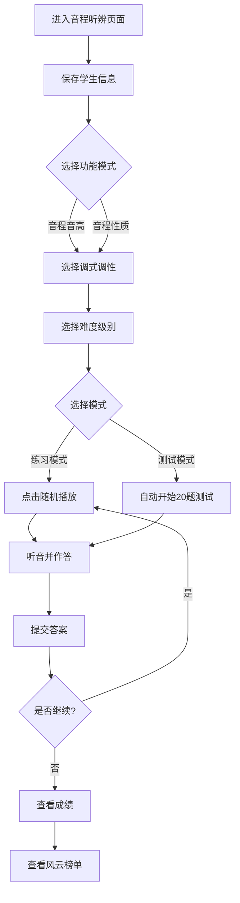
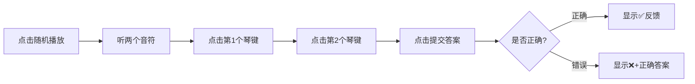
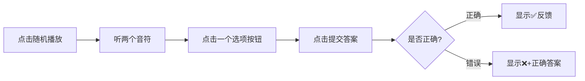
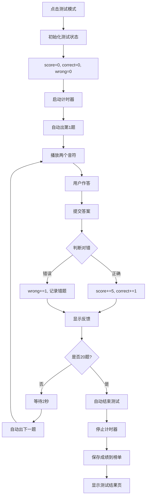
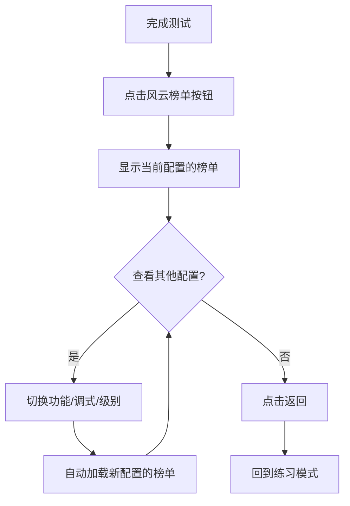

# 音程听辨使用说明

## 📋 目录
- [功能概述](#功能概述)
- [快速开始](#快速开始)
- [操作流程](#操作流程)
- [练习模式](#练习模式)
- [测试模式](#测试模式)
- [风云榜单](#风云榜单)
- [常见问题](#常见问题)

---

## 功能概述

音程听辨是音乐 ear training（练耳）的进阶模块，通过听辨两个音符之间的音高关系（音程），训练学生的和声感知能力和音程识别能力。

**核心功能：**
- ✅ 两种功能模式：音程音高、音程性质
- ✅ 12种调式调性选择（C大调、G大调、D大调等）
- ✅ 8个难度级别（根据音域范围分级）
- ✅ 实时反馈与成绩统计
- ✅ 风云榜单排名系统
- ✅ 钢琴键盘辅助学习

---

## 快速开始

### 1. 保存学生信息（可选但推荐）
```
填写：学校、班级、姓名、老师 → 点击"保存"
```
> **提示：** 保存后可参与风云榜单排名

### 2. 选择功能模式
```
① 音程音高：听辨两个具体音符（如：C4 + G4）
② 音程性质：听辨音程类型（如：纯五度、大三度）
```

### 3. 选择训练配置
```
① 选择调式调性（如：C大调）
② 选择难度级别（1级-8级）
```

### 4. 选择模式
```
点击"练习模式"或"测试模式"按钮
```

---

## 操作流程

### 完整训练流程



### 详细步骤

#### 步骤1：选择功能模式

**音程音高模式：**
- **目标**：听辨出两个具体的音符
- **作答方式**：在钢琴键盘上点击两个琴键
- **适合人群**：需要强化绝对音感的学生
- **示例**：听到 C4 + E4，需在键盘上点击 C4 和 E4

**音程性质模式：**
- **目标**：听辨出音程的类型名称
- **作答方式**：从4个选项中选择正确答案
- **适合人群**：需要强化相对音感的学生
- **示例**：听到 C4 + E4，需选择"大三度"

> **建议：** 初学者先从音程性质开始，熟悉常见音程的音响效果

#### 步骤2：配置训练参数

**调式调性：**
- 从下拉菜单选择（如：C大调、G大调、a小调等）
- 钢琴键盘会自动高亮显示该调式的可用音符
- 灰色琴键表示不在当前调式范围内

**难度级别：**
- **1级**：窄音域（如：C4-G4，5个半音）
- **2级**：较小音域（如：C4-A4，7个半音）
- **3级**：中等音域（如：C4-B4，9个半音）
- **4级**：较大音域（如：C3-C5，12个半音）
- **5级**：大音域（如：G3-D5，15个半音）
- **6级**：更大音域（如：F3-F5，17个半音）
- **7级**：很宽音域（如：D3-D5，19个半音）
- **8级**：最宽音域（如：G3-G5，21个半音）

> **注意：** 级别越高，音域越宽，可出现的音程种类越多

#### 步骤3：开始训练

**练习模式：**
1. 点击"练习模式"按钮
2. 点击"随机播放"按钮出题
3. 聆听播放的两个音符（同时或先后）
4. 根据功能模式作答：
   - **音程音高**：在钢琴键盘上点击两个琴键
   - **音程性质**：从4个选项中选择
5. 点击"提交答案"
6. 系统显示对错反馈
7. 可点击"重复播放"重新听题
8. 可点击"旋律播放"按顺序听两个音符

**测试模式：**
1. 点击"测试模式"按钮
2. 系统自动开始20题测试
3. 每题限时作答
4. 右上角显示实时成绩和用时
5. 完成20题后自动结束测试
6. 也可手动点击"结束测试"提前结束

---

## 练习模式

### 功能特点

✅ **无压力学习**：答错不扣分，可反复练习  
✅ **即时反馈**：立即显示正确答案  
✅ **自由重听**：可多次点击"重复播放"  
✅ **视觉辅助**：钢琴键盘高亮显示可用音符  
✅ **双模式支持**：音程音高和音程性质可自由切换  

### 操作按钮

| 按钮 | 功能 | 说明 |
|------|------|------|
| 随机播放 | 随机出一道音程题 | 根据当前配置生成两个音符 |
| 重复播放 | 同时重新播放两个音符 | 不限次数 |
| 旋律播放 | 按顺序播放两个音符 | 先低后高，帮助听辨 |
| 提交答案 | 提交当前选择 | 音高模式需选2个琴键，性质模式需选1个选项 |
| 显示答案 | 直接显示正确答案 | 不会时使用 |

### 界面元素

#### 音程音高模式界面
```
┌─────────────────────────────────────┐
│  [返回]  [截屏]                     │
├─────────────────────────────────────┤
│  [音程音高←激活] [音程性质]          │
│  [练习模式←激活] [测试模式]          │
├─────────────────────────────────────┤
│  调式调性: [C大调 ▼]  级别: [1级 ▼] │
├─────────────────────────────────────┤
│  状态栏: 已选择：C4 + E4（大三度）   │
├─────────────────────────────────────┤
│  [随机播放] [重复播放] [旋律播放]     │
│  [提交答案] [显示答案]                │
├─────────────────────────────────────┤
│         🎹 钢琴键盘 🎹               │
│  (点击两个琴键作答)                   │
└─────────────────────────────────────┘
```

#### 音程性质模式界面
```
┌─────────────────────────────────────┐
│  [返回]  [截屏]                     │
├─────────────────────────────────────┤
│  [音程音高] [音程性质←激活]          │
│  [练习模式←激活] [测试模式]          │
├─────────────────────────────────────┤
│  调式调性: [C大调 ▼]  级别: [1级 ▼] │
├─────────────────────────────────────┤
│  状态栏: 请选择一个音程性质           │
├─────────────────────────────────────┤
│  [随机播放] [重复播放] [旋律播放]     │
│  [提交答案] [显示答案]                │
├─────────────────────────────────────┤
│  ┌──────────┬──────────┐            │
│  │ 小二度   │ 大二度   │            │
│  ├──────────┼──────────┤            │
│  │ 小三度   │ 大三度   │            │
│  └──────────┴──────────┘            │
│  (4个选项按钮)                        │
├─────────────────────────────────────┤
│         🎹 钢琴键盘 🎹               │
│  (可点击出声辅助学习)                 │
└─────────────────────────────────────┘
```

### 作答流程

#### 音程音高模式


**选择规则：**
- 必须选择**两个不同的音符**
- 选择的顺序不重要（系统会自动排序）
- 考虑等音关系（如：C# = Db）
- 超出调式范围的琴键不可点击（灰色）

**反馈示例：**
```
✅ 答对了！
已选择：C4 + E4（大三度）

❌ 答错了。正确答案是：C4 + E4（大三度）
```

#### 音程性质模式


**选项生成：**
- 系统从所有可能的音程性质中随机选择4个
- 其中1个是正确答案
- 其他3个是干扰项

**常见音程性质：**
- 小二度、大二度
- 小三度、大三度
- 纯四度、增四度/减五度
- 纯五度
- 小六度、大六度
- 小七度、大七度
- 纯八度

**反馈示例：**
```
✅ 答对了！

❌ 答错了。正确答案是：大三度
```

### 使用技巧

#### 音程音高模式技巧

💡 **听辨方法：**
1. **先听低音**：找出较低的音符
2. **再听高音**：找出较高的音符
3. **内心哼唱**：边听边在心里唱出音高
4. **钢琴辅助**：不确定时在钢琴上试弹

💡 **记忆策略：**
- 记住常见音程的"色彩"
  - 纯五度：稳定、和谐（如《小星星》开头）
  - 大三度：明亮、欢快
  - 小三度：柔和、忧伤
  - 纯四度：开阔、庄严

#### 音程性质模式技巧

💡 **快速判断法：**
1. **数半音**：在心中数两个音之间有几个半音
   - 1个半音 = 小二度
   - 2个半音 = 大二度
   - 3个半音 = 小三度
   - 4个半音 = 大三度
   - 5个半音 = 纯四度
   - 6个半音 = 增四度/减五度
   - 7个半音 = 纯五度
   - ...

2. **联想歌曲**：用熟悉的歌曲开头来记忆
   - 纯四度：《婚礼进行曲》开头
   - 纯五度：《小星星》开头
   - 大六度：《My Bonnie》开头
   - 小七度：《Star Trek》主题曲开头

💡 **排除法：**
- 先排除明显不对的选项
- 如果听起来很和谐，可能是纯音程（纯四、纯五、纯八）
- 如果听起来有点紧张，可能是大小音程

### 钢琴键盘的特殊作用

**音程音高模式：**
- 主要作答工具
- 必须点击两个琴键才能提交

**音程性质模式：**
- 辅助学习工具
- 可点击琴键出声，帮助确认音高
- 测试模式下钢琴键盘隐藏（防止作弊）

> **重要：** 音程性质练习模式中，钢琴键盘始终显示，供学生随时点击出声，提高学习效果。

---

## 测试模式

### 功能特点

🎯 **标准化测试**：固定20题，满分100分  
⏱️ **限时作答**：记录总用时  
📊 **成绩统计**：正确数、错误数、得分率  
🏆 **榜单排名**：成绩自动计入风云榜单  
🔒 **严格模式**：禁用辅助功能，确保公平  

### 测试规则

- **题量**：20题（固定）
- **分值**：每题5分，满分100分
- **计时**：从第1题开始到最后一题结束
- **自动结束**：完成20题后自动结束
- **手动结束**：可随时点击"结束测试"提前结束

### 界面变化

#### 音程音高测试模式
```
┌─────────────────────────────────────┐
│  得分: 45  正确: 9  错误: 1         │
│  进度: 10/20  用时: 02:15.30        │
├─────────────────────────────────────┤
│  状态: ✅ 答对了！+5分               │
├─────────────────────────────────────┤
│  [随机播放] [重复播放] [旋律播放]     │
│  [提交答案]                          │
│  (显示答案已隐藏)                     │
├─────────────────────────────────────┤
│         🎹 钢琴键盘 🎹               │
│  (可点击作答，但不发声)               │
└─────────────────────────────────────┘
```

#### 音程性质测试模式
```
┌─────────────────────────────────────┐
│  得分: 45  正确: 9  错误: 1         │
│  进度: 10/20  用时: 02:15.30        │
├─────────────────────────────────────┤
│  状态: ✅ 答对了！+5分               │
├─────────────────────────────────────┤
│  [随机播放] [重复播放] [旋律播放]     │
│  [提交答案]                          │
│  (显示答案已隐藏)                     │
├─────────────────────────────────────┤
│  ┌──────────┬──────────┐            │
│  │ 小二度   │ 大二度   │            │
│  ├──────────┼──────────┤            │
│  │ 小三度   │ 大三度   │            │
│  └──────────┴──────────┘            │
│  (钢琴键盘已隐藏)                     │
└─────────────────────────────────────┘
```

### 特殊规则

#### 音程音高测试模式
- ✅ 钢琴键盘显示（用于作答）
- ❌ 点击琴键**不发声**（防止漏题）
- ✅ 琴键仍会高亮（视觉反馈）

#### 音程性质测试模式
- ❌ 钢琴键盘**完全隐藏**（防止通过弹琴确认）
- ✅ 只能通过听觉判断
- ✅ 4个选项按钮正常显示

### 测试中的限制

**禁用的功能：**
- ❌ "显示答案"按钮（隐藏）
- ❌ 切换功能模式按钮（锁定当前模式）
  - 音程音高测试中，"音程性质"按钮锁死
  - 音程性质测试中，"音程音高"按钮锁死

**保留的功能：**
- ✅ "随机播放"（自动触发）
- ✅ "重复播放"（可多次重听）
- ✅ "旋律播放"（按顺序听）
- ✅ 作答功能（琴键点击或选项选择）

### 测试流程



### 成绩计算

#### 得分计算
```javascript
总分 = 正确题数 × 5分

示例：
- 20题全对：20 × 5 = 100分
- 17题对3题错：17 × 5 = 85分
- 10题对10题错：10 × 5 = 50分
```

#### 错题记录
```javascript
// 音程音高模式错题
errorQuestions = [
    {
        question: ["C4", "E4"],           // 题目音符
        correctAnswer: ["C4", "E4"],      // 正确答案
        userAnswer: ["C4", "F4"]          // 用户答案
    }
]

// 音程性质模式错题
errorQuestions = [
    {
        question: ["C4", "E4"],           // 题目音符
        correctAnswer: "大三度",           // 正确答案
        userAnswer: "小三度"               // 用户答案
    }
]
```

### 测试策略

#### 时间管理
- ⏱️ **平均每题15-25秒**：20题约需5-8分钟
- ⏱️ **多用重复播放**：确保听清楚再作答
- ⏱️ **不要过度犹豫**：相信第一直觉

#### 音程音高模式技巧
1. **先确定低音**：找到较低的音符
2. **再确定高音**：找到较高的音符
3. **利用旋律播放**：按顺序听更容易分辨
4. **注意等音**：C# 和 Db 是同一个音

#### 音程性质模式技巧
1. **感受音程色彩**：和谐vs紧张
2. **数半音数量**：在心中默数
3. **联想歌曲**：用熟悉的旋律辅助判断
4. **排除明显错误**：先去掉不可能的选项

### 测试结束页

测试完成后显示：
1. **成绩汇总**：总分、正确率、用时
2. **详细统计**：正确数、错误数
3. **错题分析**：可查看每道错题的正确答案
4. **操作按钮**：
   - "练习模式"：返回对应功能模式的练习初始状态
   - "风云榜单"：查看当前配置的排名

**重要：** 
- 音程音高测试结束后，点击"练习模式"返回**音程音高**练习模式
- 音程性质测试结束后，点击"练习模式"返回**音程性质**练习模式

---

## 风云榜单

### 功能概述

风云榜单展示所有学生在不同配置下的测试成绩排名，激励学生不断进步。

### 数据隔离规则

榜单按照**三维配置**独立存储：
```
存储键格式：intervalLeaderboard_{功能}_{调式}_{级别}

示例：
- intervalLeaderboard_pitch_C大调_1  （音程音高+C大调+1级）
- intervalLeaderboard_quality_G大调_3  （音程性质+G大调+3级）
- intervalLeaderboard_pitch_a小调_5  （音程音高+a小调+5级）
```

**这意味着：**
- 不同功能模式的成绩分开排名（音程音高 vs 音程性质）
- 不同调式的成绩分开排名
- 不同级别的成绩分开排名
- 只有完全相同配置的成绩才会在一起比较

### 排名规则

🥇 **排序优先级：**
1. **分数优先**：高分排前面
2. **用时其次**：同分时，用时短的排前面

**示例：**
```
排名  姓名  得分  用时
1     张三  100  04:25.50  ← 满分且最快
2     李四  100  05:10.30  ← 满分但较慢
3     王五  95   04:50.20  ← 分数较低
```

### 榜单显示

**顶部配置信息：**
```
当前榜单：音程音高 | C大调 | 1级
```

**榜单列表：**
- 显示前10名
- 前三名有特殊标识（🥇🥈🥉）
- 每行显示：排名、姓名、得分、用时

### 操作功能

| 按钮 | 功能 | 说明 |
|------|------|------|
| 清空榜单 | 删除当前配置的榜单数据 | 需确认，不可恢复 |
| 返回 | 返回练习模式 | 恢复到练习模式初始状态 |

### 动态切换

在风云榜单界面可以：
1. **切换功能模式**：点击"音程音高"或"音程性质"按钮，立即显示对应功能的榜单
2. **切换调式**：更改调式下拉菜单，立即显示新调式的榜单
3. **切换级别**：更改级别下拉菜单，立即显示新级别的榜单

> **重要：** 榜单显示的是**当前界面选择的配置**对应的数据，不是练习模式的配置。

### 查看榜单流程



### 使用场景

📈 **学生自我激励：**
- 查看自己在某个配置的排名
- 设定目标超越前面的同学
- 尝试不同配置寻找优势项目

👨‍🏫 **教师教学管理：**
- 了解学生对不同配置的掌握程度
- 发现需要加强训练的音程类型
- 组织班级竞赛活动

---

## 常见问题

### Q1: 音程音高和音程性质有什么区别？

**音程音高：**
- 关注**具体音符**（如：C4 + G4）
- 训练**绝对音感**
- 作答方式：点击钢琴键盘
- 难度：较高（需要准确听出音高）

**音程性质：**
- 关注**音程类型**（如：纯五度）
- 训练**相对音感**
- 作答方式：选择选项按钮
- 难度：较低（只需判断关系）

**建议：** 初学者先练音程性质，熟练后再练音程音高

### Q2: 为什么我的成绩没有出现在榜单上？

**可能原因：**
1. ❌ 未保存学生信息（姓名必填）
2. ❌ 查看的配置与测试时的配置不一致
3. ❌ 未完成测试（中途退出）
4. ❌ 功能模式不同（音程音高 vs 音程性质）

**解决方法：**
1. 填写并保存学生信息
2. 确保榜单界面的配置（功能、调式、级别）与测试时完全一致
3. 完成至少1题后再结束测试

### Q3: 如何查看不同配置的榜单？

**方法：**
1. 进入风云榜单界面
2. 点击功能模式按钮（音程音高/音程性质）
3. 或更改调式下拉菜单
4. 或更改级别下拉菜单
5. 榜单会自动更新显示对应配置的数据

### Q4: 练习模式和测试模式有什么区别？

| 对比项 | 练习模式 | 测试模式 |
|--------|----------|----------|
| 题量 | 无限 | 固定20题 |
| 计分 | 不计分 | 每题5分，满分100 |
| 计时 | 不限时 | 记录总用时 |
| 显示答案 | ✅ 可用 | ❌ 禁用 |
| 功能模式切换 | ✅ 自由切换 | ❌ 锁定当前 |
| 钢琴键盘（性质模式） | ✅ 显示 | ❌ 隐藏 |
| 钢琴发声（音高模式） | ✅ 发声 | ❌ 不发声 |
| 榜单记录 | ❌ 不记录 | ✅ 自动记录 |
| 压力程度 | 低 | 高 |

### Q5: 如何提高音程听辨准确率？

**建议：**
1. 🎵 从低级别开始，循序渐进
2. 🔄 多使用"重复播放"和"旋律播放"
3. 🎹 结合钢琴键盘视觉和听觉记忆
4. 📝 记录常错的音程重点练习
5. 🎶 联想熟悉歌曲的开头音程
6. ⏰ 测试前先充分练习

### Q6: 测试时点击琴键为什么不发声？

**原因：** 防止漏题，确保测试公平性

**替代方案：**
- 使用"重复播放"按钮重新听题
- 使用"旋律播放"按顺序听两个音符
- 依靠内心听觉和记忆作答

### Q7: 榜单数据会丢失吗？

**数据存储：**
- 榜单数据保存在浏览器 localStorage 中
- 清除浏览器缓存会导致数据丢失
- 建议定期导出重要数据（未来版本可能支持）

**数据隔离：**
- 每个配置独立存储，互不影响
- 清空榜单只会清空当前配置的数据

---

## 快捷键提示

虽然本应用主要使用鼠标/触摸操作，但以下技巧可提升效率：

- **快速重听**：连续点击"重复播放"按钮
- **快速作答**：
  - 音高模式：直接点击两个琴键后点提交
  - 性质模式：直接点击选项后点提交
- **快速切换**：在榜单界面快速切换配置查看不同排名

---

## 技术支持

如遇问题，请检查：
1. ✅ 浏览器是否为最新版本（推荐Chrome/Firefox/Safari）
2. ✅ 是否允许网页播放音频
3. ✅ 音量是否正常开启
4. ✅ 是否在网络环境下使用（部分资源需在线加载）

---

**最后更新：** 2026年5月  
**版本：** v1.0
