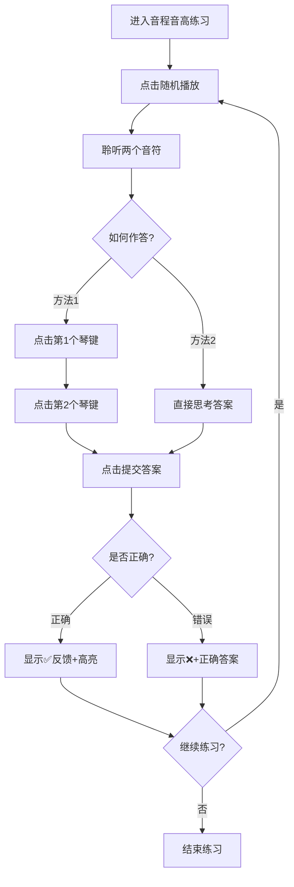
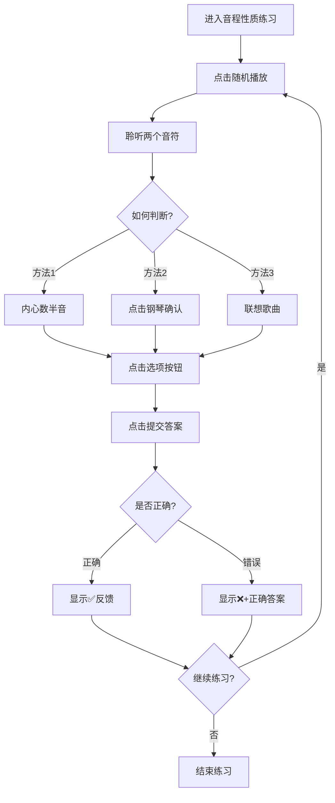
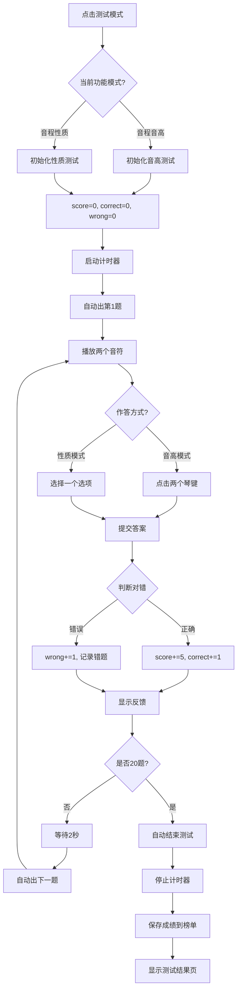

# 音程听辨模式详解

## 📋 目录
- [概述](#概述)
- [练习模式](#练习模式)
- [测试模式](#测试模式)
- [风云榜单](#风云榜单)
- [模式对比](#模式对比)
- [最佳实践](#最佳实践)

---

## 概述

音程听辨模块包含三种核心模式和两种功能类型，针对不同的学习目标和场景设计。

### 三种模式概览

| 模式 | 适用场景 | 核心目标 | 数据记录 |
|------|----------|----------|----------|
| **练习模式** | 日常训练、技能提升 | 熟练掌握音程听辨 | ❌ 不记录 |
| **测试模式** | 能力评估、成绩考核 | 检验学习成果 | ✅ 记录到榜单 |
| **风云榜单** | 竞争激励、排名查看 | 了解相对水平 | 📊 展示排名 |

### 两种功能类型

| 功能 | 训练重点 | 作答方式 | 难度 |
|------|----------|----------|------|
| **音程音高** | 绝对音感 | 点击钢琴键盘选择两个音符 | ⭐⭐⭐⭐ |
| **音程性质** | 相对音感 | 从4个选项中选择音程名称 | ⭐⭐⭐ |

---

## 练习模式

### 🎯 设计理念

**无压力学习环境**：允许犯错、鼓励探索、注重过程而非结果。

### 核心特性

#### 1. 双功能模式支持

**音程音高模式：**
```
听到两个音符 → 在钢琴上点击两个琴键 → 提交答案
```

**特点：**
- ✅ 训练绝对音感
- ✅ 钢琴键盘为主要交互工具
- ✅ 可看到选择的音符名称
- ✅ 支持等音识别（C# = Db）

**音程性质模式：**
```
听到两个音符 → 从4个选项中选择 → 提交答案
```

**特点：**
- ✅ 训练相对音感
- ✅ 选项按钮为主要交互工具
- ✅ 钢琴键盘作为辅助工具（可点击出声）
- ✅ 学习音程名称和分类

#### 2. 即时反馈机制

**音程音高反馈：**
```
✅ 答对了！
已选择：C4 + E4（大三度）

❌ 答错了。正确答案是：C4 + E4（大三度）
```

**音程性质反馈：**
```
✅ 答对了！

❌ 答错了。正确答案是：大三度
```

**反馈时长：** 短暂显示后自动清除，避免干扰下一题

#### 3. 视觉辅助系统

**钢琴键盘高亮：**
- 当前调式的可用音符以正常颜色显示
- 禁用琴键灰色且不可点击
- 已选音符保持高亮状态
- 提交后正确答案会高亮2秒

**音程性质模式的特殊性：**
- 🎹 钢琴键盘始终显示（练习模式）
- 🎹 可点击琴键出声，辅助学习
- 🎹 帮助学生建立音高与音程的联系

#### 4. 多种播放方式

**随机播放：**
- 同时播放两个音符
- 模拟真实听辨场景

**重复播放：**
- 重新同时播放两个音符
- 不限次数，直到听清楚

**旋律播放：**
- 按顺序播放：先低音后高音
- 间隔500毫秒
- 帮助分辨两个音符

### 界面布局

#### 音程音高模式
```
┌─────────────────────────────────────┐
│  [返回]  [截屏]                     │
├─────────────────────────────────────┤
│  学生信息: [学校] [班级] [姓名] [老师] [保存] │
├─────────────────────────────────────┤
│  [音程音高←激活] [音程性质]          │
│  [练习模式←激活] [测试模式]          │
├─────────────────────────────────────┤
│  调式调性: [C大调 ▼]  级别: [1级 ▼] │
├─────────────────────────────────────┤
│  状态栏: 请在琴键上选择两个音         │
├─────────────────────────────────────┤
│  [随机播放] [重复播放] [旋律播放]     │
│  [提交答案] [显示答案]                │
├─────────────────────────────────────┤
│         🎹 钢琴键盘 🎹               │
│  (点击两个琴键作答)                   │
└─────────────────────────────────────┘
```

#### 音程性质模式
```
┌─────────────────────────────────────┐
│  [返回]  [截屏]                     │
├─────────────────────────────────────┤
│  学生信息: [学校] [班级] [姓名] [老师] [保存] │
├─────────────────────────────────────┤
│  [音程音高] [音程性质←激活]          │
│  [练习模式←激活] [测试模式]          │
├─────────────────────────────────────┤
│  调式调性: [C大调 ▼]  级别: [1级 ▼] │
├─────────────────────────────────────┤
│  状态栏: 请选择一个音程性质           │
├─────────────────────────────────────┤
│  [随机播放] [重复播放] [旋律播放]     │
│  [提交答案] [显示答案]                │
├─────────────────────────────────────┤
│  ┌──────────┬──────────┐            │
│  │ 小二度   │ 大二度   │            │
│  ├──────────┼──────────┤            │
│  │ 小三度   │ 大三度   │            │
│  └──────────┴──────────┘            │
├─────────────────────────────────────┤
│         🎹 钢琴键盘 🎹               │
│  (可点击出声辅助学习)                 │
└─────────────────────────────────────┘
```

### 操作流程

#### 音程音高模式流程



#### 音程性质模式流程



### 使用技巧

#### 音程音高模式技巧

💡 **听辨步骤：**
1. **专注低音**：先找出较低的音符
2. **定位高音**：再找出较高的音符
3. **钢琴验证**：不确定时在钢琴上试弹
4. **注意等音**：记住 C#=Db, D#=Eb 等等音关系

💡 **记忆策略：**
- 建立"音高地图"：记住每个音符在键盘上的位置
- 利用调式感：在C大调中，白键更熟悉
- 反复强化：对常错的音符组合重点练习

#### 音程性质模式技巧

💡 **快速判断法：**

**方法1：数半音**
```
在心中默数两个音之间的半音数量：

1个半音  → 小二度  (如: C-C#)
2个半音  → 大二度  (如: C-D)
3个半音  → 小三度  (如: C-D#)
4个半音  → 大三度  (如: C-E)
5个半音  → 纯四度  (如: C-F)
6个半音  → 增四度  (如: C-F#)
7个半音  → 纯五度  (如: C-G)
8个半音  → 小六度  (如: C-G#)
9个半音  → 大六度  (如: C-A)
10个半音 → 小七度  (如: C-A#)
11个半音 → 大七度  (如: C-B)
12个半音 → 纯八度  (如: C-C5)
```

**方法2：感受色彩**
```
和谐稳定：
- 纯四度、纯五度、纯八度（完全协和）
- 大三度、小三度、大六度、小六度（不完全协和）

紧张不稳定：
- 小二度、大二度、小七度、大七度（不协和）
- 增四度/减五度（极不协和，三全音）
```

**方法3：联想歌曲**
```
纯四度：《婚礼进行曲》开头 "登登登登"
纯五度：《小星星》开头 "一闪一闪"
大六度：《My Bonnie》开头 "My Bon-nie"
小七度：《Star Trek》主题曲开头
纯八度：《Somewhere Over the Rainbow》开头 "Some-where"
```

💡 **钢琴辅助技巧：**
- 听到音程后，在钢琴上弹出低音
- 然后尝试找到高音
- 通过视觉确认音程关系
- 逐步减少依赖，培养内心听觉

### 常见问题解决

**Q: 为什么有些琴键是灰色的？**  
A: 这些琴键不在当前选择的调式范围内。例如C大调只有白键可用。

**Q: 音程音高模式中，选择顺序有影响吗？**  
A: 没有影响。系统会自动将选择的两个音符从低到高排序。

**Q: 如何提高音程性质的判断速度？**  
A: 
- 多练习"数半音"法，形成条件反射
- 记忆常见音程的歌曲联想
- 多做快速反应训练

**Q: 音程性质模式中，钢琴键盘有什么用？**  
A: 
- 练习模式下可点击出声，帮助确认音高
- 可以弹出听到的音程，加深理解
- 测试模式下会隐藏，防止作弊

---

## 测试模式

### 🎯 设计理念

**标准化能力评估**：固定题量、统一评分、客观公正、可横向比较。

### 核心特性

#### 1. 标准化测试流程

**共同规则：**
- **固定题量**：20题（不可更改）
- **统一分值**：每题5分，满分100分
- **自动计时**：从第1题到最后一题的总用时
- **自动流转**：答完一题后2秒自动出下一题

**功能模式差异：**

**音程音高测试：**
- ✅ 钢琴键盘显示（用于作答）
- ❌ 点击琴键**不发声**（防止漏题）
- ✅ 琴键仍会高亮（视觉反馈）

**音程性质测试：**
- ❌ 钢琴键盘**完全隐藏**（防止通过弹琴确认）
- ✅ 只能通过听觉判断
- ✅ 4个选项按钮正常显示

#### 2. 实时成绩追踪

```
┌──────────────────────────┐
│  得分: 85  正确: 17      │
│  错误: 3   进度: 18/20   │
│  用时: 05:32.45          │
└──────────────────────────┘
```

**更新时机：**
- 每答完一题立即更新
- 正确：得分+5，正确数+1
- 错误：错误数+1，记录错题详情

#### 3. 严格模式限制

**禁用的功能：**
- ❌ "显示答案"按钮（隐藏）
- ❌ 切换功能模式按钮（锁定当前模式）
  - 音程音高测试中，"音程性质"按钮锁死（透明度40%，不可点击）
  - 音程性质测试中，"音程音高"按钮锁死（透明度40%，不可点击）

**保留的功能：**
- ✅ "随机播放"（自动触发）
- ✅ "重复播放"（可多次重听）
- ✅ "旋律播放"（按顺序听）
- ✅ 作答功能（琴键点击或选项选择）

**设计理由：** 
- 防止作弊，确保测试公平性
- 音程音高模式禁止发声，防止学生通过听琴键确认答案
- 音程性质模式隐藏钢琴，迫使学生依靠听觉判断

#### 4. 自动结束机制

**触发条件：**
1. **完成20题**：自动结束测试
2. **手动点击**："结束测试"按钮提前结束

**结束后的操作：**
- 停止计时器
- 隐藏计分板、钢琴键盘和按钮
- 显示测试结果分析页
- 自动保存成绩到风云榜单

### 界面变化

#### 音程音高测试进行中
```
┌─────────────────────────────────────┐
│  得分: 45  正确: 9  错误: 1         │
│  进度: 10/20  用时: 02:15.30        │
├─────────────────────────────────────┤
│  [音程音高←激活] [音程性质🔒]        │
│  状态: ✅ 答对了！+5分               │
├─────────────────────────────────────┤
│  [随机播放] [重复播放] [旋律播放]     │
│  [提交答案]                          │
│  (显示答案已隐藏)                     │
├─────────────────────────────────────┤
│         🎹 钢琴键盘 🎹               │
│  (可点击作答，但不发声)               │
└─────────────────────────────────────┘
```

#### 音程性质测试进行中
```
┌─────────────────────────────────────┐
│  得分: 45  正确: 9  错误: 1         │
│  进度: 10/20  用时: 02:15.30        │
├─────────────────────────────────────┤
│  [音程音高🔒] [音程性质←激活]        │
│  状态: ✅ 答对了！+5分               │
├─────────────────────────────────────┤
│  [随机播放] [重复播放] [旋律播放]     │
│  [提交答案]                          │
│  (显示答案已隐藏)                     │
├─────────────────────────────────────┤
│  ┌──────────┬──────────┐            │
│  │ 小二度   │ 大二度   │            │
│  ├──────────┼──────────┤            │
│  │ 小三度   │ 大三度   │            │
│  └──────────┴──────────┘            │
│  (钢琴键盘已隐藏)                     │
└─────────────────────────────────────┘
```

### 测试流程详解



### 成绩计算规则

#### 得分计算
```javascript
总分 = 正确题数 × 5分

示例：
- 20题全对：20 × 5 = 100分
- 17题对3题错：17 × 5 = 85分
- 10题对10题错：10 × 5 = 50分
```

#### 用时计算
```
从第1题播放开始 → 到第20题作答结束

精度：毫秒级（显示为 MM:SS.ms）
示例：05:32.45 表示 5分32秒450毫秒
```

#### 错题记录

**音程音高模式：**
```javascript
errorQuestions = [
    {
        question: ["C4", "E4"],           // 题目音符
        correctAnswer: ["C4", "E4"],      // 正确答案
        userAnswer: ["C4", "F4"]          // 用户答案
    }
]
```

**音程性质模式：**
```javascript
errorQuestions = [
    {
        question: ["C4", "E4"],           // 题目音符
        correctAnswer: "大三度",           // 正确答案
        userAnswer: "小三度"               // 用户答案
    }
]
```

### 测试策略

#### 时间管理
- ⏱️ **平均每题15-25秒**：20题约需5-8分钟
- ⏱️ **多用重复播放**：确保听清楚再作答
- ⏱️ **不要过度犹豫**：相信第一直觉

#### 音程音高模式技巧
1. **先确定低音**：找到较低的音符
2. **再确定高音**：找到较高的音符
3. **利用旋律播放**：按顺序听更容易分辨
4. **注意等音**：C# 和 Db 是同一个音
5. **钢琴无声**：记住点击琴键不会发声，只能靠听

#### 音程性质模式技巧
1. **感受音程色彩**：和谐vs紧张
2. **数半音数量**：在心中默数
3. **联想歌曲**：用熟悉的旋律辅助判断
4. **排除明显错误**：先去掉不可能的选项
5. **无钢琴辅助**：测试时看不到钢琴，必须依靠听觉

### 测试结束页

测试完成后显示：
1. **成绩汇总**：总分、正确率、用时
2. **详细统计**：正确数、错误数
3. **错题分析**：可查看每道错题的正确答案
4. **操作按钮**：
   - "练习模式"：返回对应功能模式的练习初始状态
   - "风云榜单"：查看当前配置的排名

**重要行为：**
```
音程音高测试结束 → 点击"练习模式" → 返回音程音高练习模式
音程性质测试结束 → 点击"练习模式" → 返回音程性质练习模式
```

**界面恢复：**
- 音程音高：显示钢琴键盘，隐藏性质选项按钮
- 音程性质：显示钢琴键盘和性质选项按钮
- 解锁所有功能按钮
- 重置计数器

---

## 风云榜单

### 🎯 设计理念

**激励与竞争**：通过排名激发学习动力，提供客观的能力参照系。

### 核心特性

#### 1. 多维度数据隔离

**存储结构：**
```
intervalLeaderboard_{功能}_{调式}_{级别}

实际示例：
├─ intervalLeaderboard_pitch_C大调_1
├─ intervalLeaderboard_pitch_C大调_2
├─ intervalLeaderboard_quality_C大调_1
├─ intervalLeaderboard_quality_G大调_3
├─ intervalLeaderboard_pitch_a小调_5
└─ ... (共 2功能 × 12调式 × 8级别 = 192个独立榜单)
```

**隔离意义：**
- 🎯 **公平比较**：相同功能和难度下比较才有意义
- 📊 **精准定位**：知道自己在哪个配置最强
- 🎓 **渐进挑战**：可在不同配置间逐步提升

**与单音听辨的区别：**
- 单音：4声部 × 12调式 × 8级别 = 384个榜单
- 音程：2功能 × 12调式 × 8级别 = 192个榜单

#### 2. 智能排序算法

**排序规则：**
```javascript
leaderboard.sort((a, b) => {
    if (b.score !== a.score) {
        return b.score - a.score;  // 1️⃣ 分数降序
    }
    return a.time - b.time;        // 2️⃣ 用时升序
});
```

**排序示例：**
```
原始数据:
- 张三: 95分, 04:30.20
- 李四: 100分, 05:15.50
- 王五: 100分, 04:45.30
- 赵六: 90分, 03:50.10

排序后:
🥇 1. 李四: 100分, 05:15.50  ← 满分排最前
🥈 2. 王五: 100分, 04:45.30  ← 同分看用时
🥉 3. 张三: 95分, 04:30.20   ← 分数优先
   4. 赵六: 90分, 03:50.10   ← 分数最低
```

#### 3. 动态配置切换

**实时响应：**
```
用户操作                      系统响应
──────────────────────────────────────────
点击"音程性质"按钮      →    加载 quality 的榜单
选择"G大调"             →    加载 G大调 的榜单
选择"3级"               →    加载 3级 的榜单
```

**实现机制：**
```javascript
// 监听功能模式切换
pitchBtn.addEventListener('click', () => {
    switchToPitchIdentificationInterval();
    if (currentMode === 'leaderboard') {
        renderIntervalLeaderboard();  // 重新渲染
        lockIntervalFunctionButtons(); // 锁定另一按钮
    }
});

qualityBtn.addEventListener('click', () => {
    switchToQualityIdentificationInterval();
    if (currentMode === 'leaderboard') {
        renderIntervalLeaderboard();  // 重新渲染
        lockIntervalFunctionButtons(); // 锁定另一按钮
    }
});

// 监听调式选择器变化
scaleSelect.addEventListener('change', () => {
    if (currentMode === 'leaderboard') {
        renderIntervalLeaderboard();  // 重新渲染
    }
});

// 监听级别选择器变化
difficultySelect.addEventListener('change', () => {
    if (currentMode === 'leaderboard') {
        renderIntervalLeaderboard();  // 重新渲染
    }
});
```

#### 4. 可视化排名展示

**榜单结构：**
```
┌──────────────────────────────────────┐
│  当前榜单：音程音高 | C大调 | 1级     │
├──────────────────────────────────────┤
│  排名    姓名    得分    用时         │
├──────────────────────────────────────┤
│  🥇 1    张三    100    04:25.50     │
│  🥈 2    李四    100    05:10.30     │
│  🥉 3    王五    95     04:50.20     │
│     4    赵六    90     05:05.15     │
│     5    孙七    85     04:55.40     │
│     ...                              │
├──────────────────────────────────────┤
│  [清空榜单]  [返回]                   │
└──────────────────────────────────────┘
```

**视觉设计：**
- 🥇 **金牌**：第1名，金色高亮
- 🥈 **银牌**：第2名，银色高亮
- 🥉 **铜牌**：第3名，铜色高亮
- **普通排名**：4-10名，标准样式

**配置信息显示：**
- 顶部清晰显示当前查看的配置
- 包括：功能模式、调式调性、级别
- 帮助用户确认正在查看的榜单

### 数据生命周期

#### 1. 数据创建
```
测试结束 → updateIntervalLeaderboard() → 保存到 localStorage
```

**保存时机：**
- 完成20题自动结束
- 手动点击"结束测试"
- 至少完成1题才会记录

**保存内容：**
```javascript
{
    name: "张三",
    school: "XX音乐学院",
    majorClass: "2024级1班",
    score: 95,
    time: 285.50,  // 秒
    function: "pitch",  // 或 "quality"
    scale: "C大调",
    level: 1,
    date: "2026-05-14 14:30:25"
}
```

#### 2. 数据读取
```
进入榜单 → renderIntervalLeaderboard() → 从 localStorage 加载
```

**读取逻辑：**
```javascript
const currentFunction = intervalAppState.currentFunction || 'pitch';
const currentScale = intervalAppState.currentScale || '未选择';
const currentLevel = difficultySelect.value || '未选择';

const storageKey = `intervalLeaderboard_${currentFunction}_${currentScale}_${currentLevel}`;
const savedData = localStorage.getItem(storageKey);
const leaderboard = savedData ? JSON.parse(savedData) : [];
```

#### 3. 数据更新
```
新测试完成 → 添加新记录 → 重新排序 → 保留前10名 → 保存
```

**更新流程：**
```javascript
// 1. 加载现有数据
const leaderboard = JSON.parse(localStorage.getItem(key)) || [];

// 2. 添加新记录
leaderboard.push(newRecord);

// 3. 排序
leaderboard.sort((a, b) => {
    if (b.score !== a.score) return b.score - a.score;
    return a.time - b.time;
});

// 4. 截取前10名
leaderboard = leaderboard.slice(0, 10);

// 5. 保存
localStorage.setItem(key, JSON.stringify(leaderboard));
```

#### 4. 数据删除
```
点击"清空榜单" → 确认对话框 → 删除 localStorage 数据
```

**清空范围：**
- 只清空**当前配置**的榜单
- 其他配置的榜单不受影响

**示例：**
```
当前：音程音高 + C大调 + 1级
清空后：intervalLeaderboard_pitch_C大调_1 被删除

但以下数据保留：
- intervalLeaderboard_pitch_C大调_2
- intervalLeaderboard_quality_C大调_1
- intervalLeaderboard_pitch_G大调_1
```

### 使用场景

#### 学生视角

**自我评估：**
```
步骤：
1. 完成一次测试
2. 进入风云榜单
3. 查看自己的排名
4. 分析与前名的差距

示例思考：
"我在音程性质C大调1级排第5名，
 距离第1名还差5分和40秒，
 下次目标是进入前3名！"
```

**优势发现：**
```
操作：
1. 依次切换不同配置
2. 观察在各配置的排名
3. 找出自己的强项

示例发现：
"我在音程性质表现更好，
 音程音高反而排名靠后，
 说明我相对音感强于绝对音感。"
```

**目标设定：**
```
SMART目标示例：
- Specific: 在音程性质G大调3级进入前3名
- Measurable: 当前排名第8，需要提升5位
- Achievable: 最高分100分，我已有90分
- Relevant: 这是我正在训练的难点
- Time-bound: 两周内达成
```

#### 教师视角

**班级监控：**
```
检查清单：
□ 哪些学生在榜单上？（参与度）
□ 各配置的平均分是多少？（整体水平）
□ 有没有异常高分或低分？（特殊情况）
□ 哪些配置没人测试？（盲区发现）
□ 音程音高 vs 音程性质，哪个更难？
```

**教学调整：**
```
数据分析：
- 如果大部分学生在音程音高得分低
  → 加强绝对音感训练
  
- 如果某个调式通过率太低
  → 增加该调式的课堂练习
  
- 如果高级别没人敢挑战
  → 鼓励学生逐步提升难度
```

**竞赛组织：**
```
班级比赛方案：
1. 统一配置：音程性质 + C大调 + 3级
2. 规定时间：本周内完成测试
3. 查看榜单：周五公布排名
4. 奖励机制：前3名获得小奖品
5. 分组竞赛：音程音高组 vs 音程性质组
```

### 技术细节

#### 数据存储位置
```
浏览器 localStorage
键名格式：intervalLeaderboard_{function}_{scale}_{level}
数据格式：JSON数组
大小限制：每个域名约5-10MB（足够存储大量记录）
```

#### 数据持久性
```
✅ 刷新页面：数据保留
✅ 关闭浏览器：数据保留
✅ 重启电脑：数据保留
❌ 清除浏览器缓存：数据丢失
❌ 更换浏览器：数据不共享
❌ 更换设备：数据不同步
```

#### 性能优化
```
- 只保留前10名：减少存储空间
- 按需加载：只在查看榜单时读取
- 本地存储：无需网络请求，响应迅速
- 动态渲染：切换配置时立即更新
```

---

## 模式对比

### 功能对比表

| 功能 | 练习模式 | 测试模式 | 风云榜单 |
|------|----------|----------|----------|
| **出题方式** | 手动点击 | 自动连续 | 不出题 |
| **题量限制** | 无限 | 20题 | - |
| **计分系统** | 无 | 每题5分 | 显示历史分数 |
| **计时功能** | 无 | 有 | 显示历史用时 |
| **显示答案** | ✅ | ❌ | - |
| **旋律播放** | ✅ | ✅ | - |
| **重复播放** | ✅ | ✅ | - |
| **钢琴键盘（音高）** | 完整显示+发声 | 显示但不发声 | 隐藏 |
| **钢琴键盘（性质）** | 显示+可发声 | 完全隐藏 | 隐藏 |
| **功能模式切换** | 自由切换 | 锁定当前 | 切换即换榜单 |
| **调式切换** | 自由切换 | 自由切换 | 切换即换榜单 |
| **级别切换** | 自由切换 | 自由切换 | 切换即换榜单 |
| **成绩记录** | ❌ | ✅ | 📊 展示 |
| **压力程度** | 低 | 高 | 中 |
| **适用阶段** | 学习期 | 考核期 | 反思期 |

### 音程音高 vs 音程性质对比

| 对比项 | 音程音高 | 音程性质 |
|--------|----------|----------|
| **训练目标** | 绝对音感 | 相对音感 |
| **作答方式** | 点击钢琴键盘 | 选择选项按钮 |
| **难度等级** | ⭐⭐⭐⭐ | ⭐⭐⭐ |
| **钢琴依赖** | 高（主要工具） | 低（辅助工具） |
| **测试时钢琴** | 显示但不发声 | 完全隐藏 |
| **适合人群** | 有钢琴基础 | 初学者友好 |
| **学习曲线** | 陡峭 | 平缓 |
| **应用场景** | 专业音乐训练 | 通用音乐素养 |

### 使用场景矩阵

```
                    初学者    进阶者    高手
音程性质-练习        ✅✅✅    ✅✅      ✅
音程性质-测试        ⚠️       ✅✅✅    ✅✅✅
音程音高-练习        ⚠️       ✅✅✅    ✅✅✅
音程音高-测试        ❌       ⚠️       ✅✅✅
风云榜单             ⚠️       ✅✅      ✅✅✅

图例：
✅✅✅ 强烈推荐
✅✅   推荐使用
⚠️     谨慎使用（可能挫败信心）
❌     不推荐（难度过高）
```

### 学习路径建议


---

## 最佳实践

### 学习策略

#### 1. 渐进式训练法

**阶段1：音程性质入门（1-2周）**
```
- 音程性质 + C大调 + 1-2级
- 练习模式为主，熟悉基本音程
- 目标：准确率达到80%以上
- 重点：掌握小二度到大三度
```

**阶段2：音程性质进阶（3-4周）**
```
- 音程性质 + 多种调式 + 3-5级
- 开始尝试测试模式
- 目标：在多个调式达到75%以上
- 重点：掌握纯四度到纯八度
```

**阶段3：音程音高入门（5-6周）**
```
- 音程音高 + C大调 + 1-3级
- 大量练习模式，建立音高地图
- 目标：能准确听出常见音程
- 重点：结合钢琴键盘视觉记忆
```

**阶段4：双模式并行（7-8周）**
```
- 两种模式交替练习
- 定期测试，查看榜单排名
- 目标：进入榜单前5名
- 重点：提升反应速度
```

**阶段5：全面挑战（9周+）**
```
- 所有调式 + 高级别
- 追求满分和快速反应
- 目标：多个配置进入前3名
- 重点：内心听觉培养
```

#### 2. 刻意练习原则

```
✓ 明确目标：每次练习聚焦一种音程
✓ 即时反馈：利用练习模式的反馈功能
✓ 走出舒适区：逐步提升难度和调式复杂度
✓ 重复强化：对薄弱环节反复训练
✓ 休息间隔：每20分钟休息5分钟
✓ 多感官参与：听觉+视觉+触觉（钢琴）
```

#### 3. 测试准备清单

```
测试前检查：
□ 充分练习过当前配置
□ 环境安静，无干扰
□ 耳机/音箱音量适中
□ 精神状态良好
□ 时间充裕（至少预留10分钟）
□ 已保存学生信息
□ 了解测试规则（特别是钢琴无声/隐藏）
```

### 常见问题解决

#### Q1: 音程音高总是听不准？

**原因分析：**
- 绝对音感尚未建立
- 钢琴键盘位置不熟悉
- 缺乏系统的音高记忆训练

**解决方案：**
1. 先从音程性质开始，培养相对音感
2. 每天花10分钟熟悉钢琴键盘
3. 使用练习模式，反复听同一音程
4. 边听边在钢琴上弹奏，建立联系
5. 记录常错的音符组合，重点突破

#### Q2: 音程性质判断速度慢？

**提升策略：**
1. **数半音训练**：每天练习快速数半音
2. **歌曲联想**：为每个音程找一首熟悉的歌
3. **色彩记忆**：记住每种音程的听觉色彩
4. **限时练习**：给自己设定5秒作答时限
5. **批量训练**：连续做20题，培养节奏感

#### Q3: 测试时紧张导致发挥失常？

**应对方法：**
1. **模拟测试**：平时练习时就限时、计分
2. **深呼吸**：测试前做3次深呼吸
3. **专注过程**：不要想分数，专注听音
4. **接受失误**：允许自己错几题，保持平常心
5. **多次测试**：多参加测试，适应考试氛围

#### Q4: 榜单排名一直不前？

**提升策略：**
1. **分析差距**：查看前名的分数和用时
2. **针对性训练**：
   - 分数低 → 提高准确率，多练习
   - 用时长 → 加快反应速度，限时训练
3. **调整配置**：尝试自己擅长的调式或级别
4. **请教老师**：获取专业指导和反馈
5. **同伴学习**：和同学一起练习，互相激励

### 数据备份建议

虽然数据存储在本地，但建议：
1. 📸 **定期截屏**：重要成绩截图保存
2. 📝 **手工记录**：用纸笔记录关键数据
3. 💾 **导出功能**：未来版本可能支持数据导出
4. 🔄 **多设备同步**：在不同设备上分别测试

### 高级技巧

#### 内心听觉培养

**什么是内心听觉？**
- 不依赖外部声音，在脑海中"听到"音高的能力
- 专业音乐家的核心技能之一

**培养方法：**
1. **默唱训练**：听到音符后，在心里默唱出来
2. **预判练习**：播放前猜测是什么音程
3. **回忆训练**：听完一段旋律后，凭记忆弹出
4. **想象练习**：闭上眼睛，想象某个音程的声音
5. **对比训练**：比较两个音程的差异

#### 调性感建立

**什么是调性感？**
- 对调式主音的感知能力
- 能在任何调式中快速找到do re mi

**培养方法：**
1. **主音定位**：每次练习前先弹主音，建立调性中心
2. **音阶练习**：熟悉每个调式的音阶结构
3. **和弦辅助**：弹奏主和弦，感受和声背景
4. **移调训练**：同一旋律在不同调式中练习
5. **即兴创作**：在当前调式中即兴演奏

#### 快速反应训练

**目标：** 将反应时间缩短到3秒以内

**训练方法：**
1. **闪卡练习**：快速显示音程名称，立即说出半音数
2. **限时答题**：给自己设定越来越短的时限
3. **批量测试**：连续做50题，不休息
4. **干扰训练**：在有噪音的环境中练习
5. **多任务训练**：边听音程边做简单计算

---

## 总结

音程听辨的三种模式和两种功能构成了完整的学习体系：

```
音程性质练习 → 音程性质测试 → 查看榜单
     ↓              ↓              ↓
相对音感培养   能力评估      激励反思
     ↓              ↓              ↓
音程音高练习 → 音程音高测试 → 查看榜单
     ↓              ↓              ↓
绝对音感培养   能力评估      激励反思
     ↓              ↓              ↓
   ← ← ← 循环迭代，全面提升 ← ← ←
```

**核心理念：**
- 🎯 **练习模式**：重在过程，允许犯错，双模式自由切换
- 🎯 **测试模式**：重在结果，客观评估，严格模式限制
- 🎯 **风云榜单**：重在比较，激发动力，多维配置隔离

**成功关键：**
1. 从音程性质入手，循序渐进
2. 坚持每日练习，培养听觉敏感度
3. 定期测试检验成果，查看榜单定位
4. 善用钢琴辅助，但不要过度依赖
5. 保持积极心态，享受学习过程

**进阶路径：**
```
初学者: 音程性质 + 低级
```
